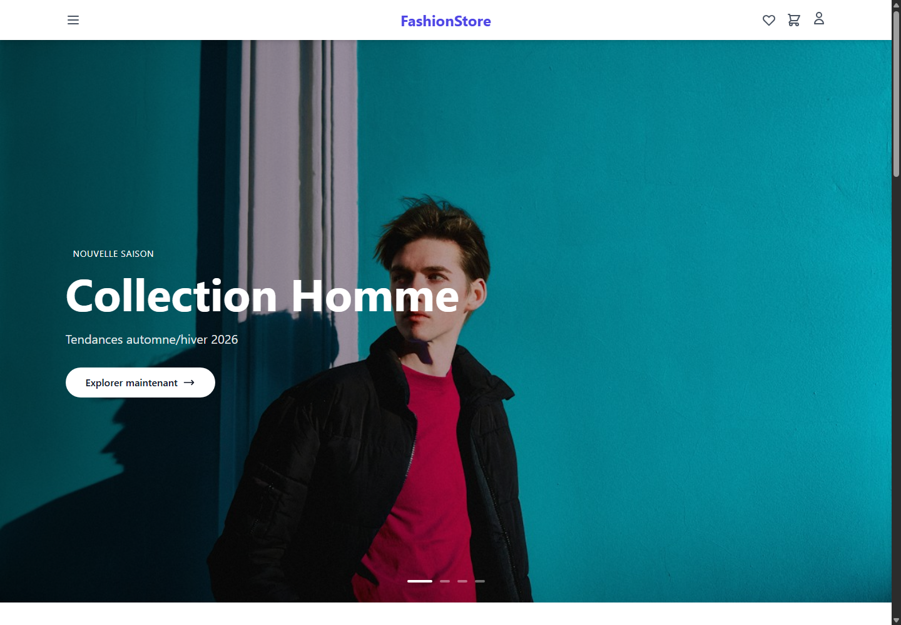

# FashionStore

[](https://github.com/Mouad-El-Aouiz/fashionstore-symfony-react/actions/workflows/ci.yml)

FashionStore est une application e-commerce de démonstration en français, développée avec React et Symfony. Elle permet de parcourir un catalogue fictif, de gérer un compte, une liste de favoris et un panier.

> **État du projet :** le paiement en ligne n'est pas activé. La page de paiement indique qu'il sera disponible dans une prochaine version. Le déploiement public est en pause ; ce dépôt est actuellement préparé pour présenter le projet et son code.

## Aperçu



## Fonctionnalités

- Catalogue avec recherche, filtres, catégories et fiches produit
- Création de compte, connexion et confirmation par e-mail
- Authentification par cookies `HttpOnly` et protection CSRF
- Favoris et panier réservés aux utilisateurs connectés
- Profil utilisateur et consultation des commandes
- Interface responsive en français

## Technologies

| Partie | Technologies |
| --- | --- |
| Frontend | React 18, Vite, Redux Toolkit, Tailwind CSS |
| Backend | PHP 8.3, Symfony 7.4, Doctrine ORM |
| Base de données | PostgreSQL 16 |
| Environnement local | Docker Compose |

## Démarrage local

### Prérequis

- Docker Desktop avec Docker Compose
- Node.js 22 ou une version compatible avec Vite

### 1. Démarrer l'API et les services locaux

Dans PowerShell, depuis le dossier `backend-symfony` :

```powershell
Copy-Item .env.example .env
docker compose up --build -d
```

L'API est disponible sur `http://localhost:8001`. PostgreSQL utilise le port
`5433` sur la machine locale, et Mailpit reçoit les e-mails de développement à
`http://localhost:8025`.

### 2. Démarrer l'application React

Dans un autre terminal, depuis le dossier `frontend` :

```powershell
npm ci
npm run dev
```

Ouvrir `http://localhost:5173`. Vite relaie automatiquement les requêtes `/api`
vers le backend. Les services et identifiants Docker Compose sont réservés au
développement local.

## Vérifications

Build du frontend, depuis `frontend` :

```powershell
npm ci
npm run build
```

Vérifications du backend, depuis `backend-symfony` après le démarrage de Docker
Compose :

```powershell
docker compose exec app php bin/console lint:container --env=prod
docker compose exec app php bin/console lint:yaml config --parse-tags
docker compose exec app php bin/console doctrine:schema:validate --skip-sync
```

Le workflow GitHub Actions exécute ces vérifications à chaque push et pull
request vers `main`, et vérifie aussi la construction de l'image Docker de
production.

## Sécurité et limites de la démo

- Ne publiez jamais de fichier `.env`, de clé JWT privée ou de secret.
- Utilisez les paramètres et données fictifs locaux uniquement pour le
  développement.
- Le paiement n'est pas disponible ; aucune commande ne peut être payée en ligne.
- L'envoi de courriels réel et le déploiement public ne sont pas configurés dans
  ce dépôt pour le moment.
